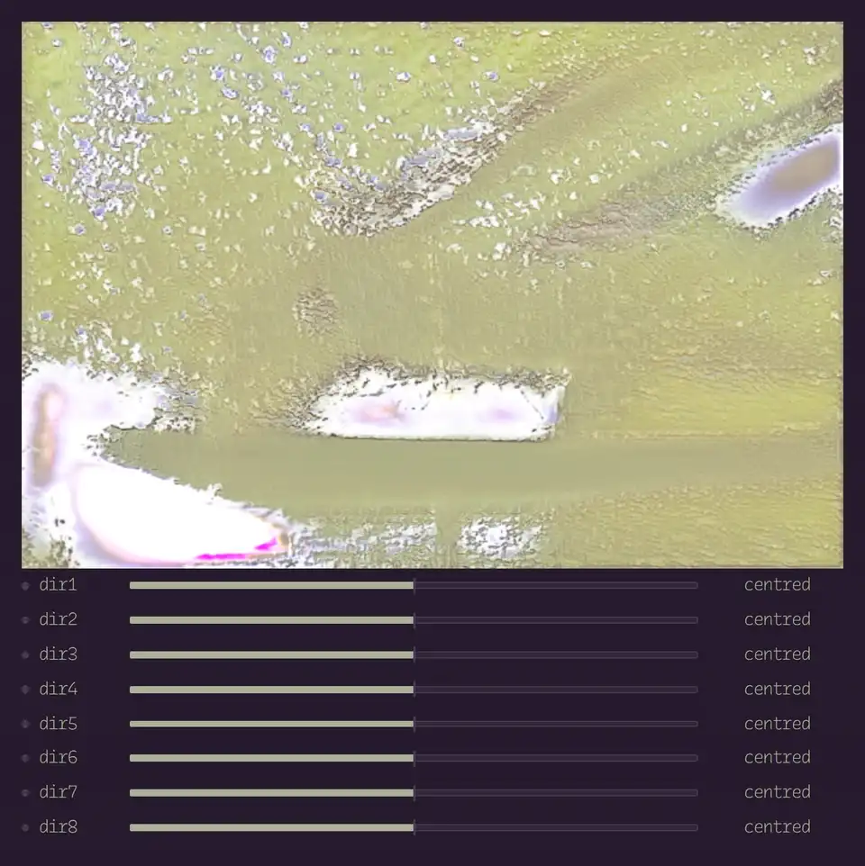
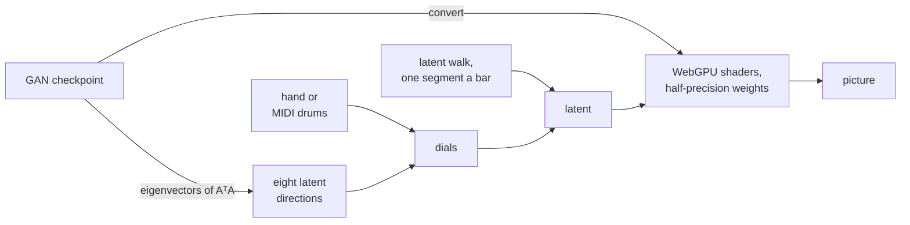

# ganlive

[ganlive](https://gustavecortal.com/ganlive/): real-time latent space exploration of GANs trained on [my photographs](https://huggingface.co/collections/gustavecortal/ganlive-6ac56a61006a78b3e1ff5406), played by hand or by a drum machine over MIDI. The [live demo](https://gustavecortal.com/ganlive/) runs in the browser on WebGPU. This repository converts a GAN for it and plays it on the desktop.

<p align="center">
  <a href="https://gustavecortal.com/ganlive/"></a>
</p>

## Play in your browser

Open [the player](https://gustavecortal.com/ganlive/) in a browser with WebGPU, such as a current Chrome, Edge, Firefox or Safari. The model downloads once and runs on your graphics card, whatever its make. Drag a dial to hold it, and let go to return it to the preset. To play from a drum machine, open the Drums tab and press Connect MIDI.

## Bring your own GAN

Convert a FastGAN or StyleGAN2 checkpoint once, with Python 3.10 to 3.13 and [uv](https://docs.astral.sh/uv/getting-started/installation/), then upload it to the Hugging Face Hub:

```bash
git clone https://github.com/gustavecortal/ganlive.git
cd ganlive
uv venv --python 3.12
uv pip install -e ".[convert]" huggingface_hub
uv run --no-sync ganlive convert path/to/checkpoint.pt
uv run --no-sync hf auth login
uv run --no-sync hf upload <you>/<model> runs/engine/<name> engine
```

Then play it at `https://gustavecortal.com/ganlive/?model=https://huggingface.co/<you>/<model>`. NVIDIA's StyleGAN2-ADA `.pkl` files are [imported](docs/guide.md#stylegan2) first. To train a FastGAN on your own photographs, see [gantrain](https://github.com/gustavecortal/gantrain).

## How it works



Converting compiles the generator into WebGPU compute shaders, one per operation and specialized to its shapes, with half-precision weights. It also finds the dials. Eight dials push the latent along directions from [closed-form factorization](https://arxiv.org/abs/2007.06600), the leading eigenvectors of AᵀA, where A is the weight that reads the latent. A direction is kept only if it changes the picture at least twice as much as a random direction of the same length, and each dial is calibrated so that equal turns make equal visible change. Other dials scale FastGAN's skip-layer excitation, which sets how much a coarse stage shapes a finer one, or add the network's noise.

The latent walks by spherical interpolation between random draws, one segment per bar. Over MIDI, a drum machine's clock sets the tempo, each hit pushes the dials routed to it with an exponential decay, and its knobs hold them. On a $350 GPU, lichen, a FastGAN at 3072×2048, draws 87 frames a second in the browser.

The [user guide](docs/guide.md) covers the desktop player, which plays models from your disk, reacts to audio input and records with a guide track, and the [development setup](docs/guide.md#development).

## License

The code is under the [MIT license](LICENSE). Model weights keep their original licenses.
